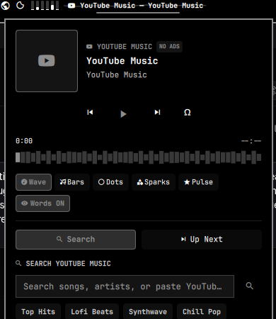

# 🎵 YouTube Music Flow (`omarchy-plugin-yt-music`)

An Omarchy Quickshell bar widget and floating player panel providing ad-free YouTube Music search and streaming with live soundwave visualizers.



## Features

- **Ad-Free YouTube Music Streaming**: Streams YouTube and YouTube Music audio streams directly through `mpv` without ads or background bloat.
- **Sub-Second Search Bar**: Fast song, artist, album, and playlist search using YouTube Music's Innertube API and `yt-dlp`.
- **Direct Link Support**: Paste any YouTube video URL or ID to play immediately.
- **Continuous Soundwave Visualizer**: Dynamic PipeWire audio visualizer in the top bar capsule with 5 switchable modes: Wave, Bars, Dots, Sparks, and Pulse.
- **Floating Player Window**: Album cover artwork, waveform seek bar, playback controls, lyrics launcher, and vibe chips ("Top Hits", "Lofi Beats", "Synthwave", "Chill Pop", "Rock Classics").

---

## Installation & Setup

```bash
omarchy plugin add [https://github.com/SushantKr-Me/omarchy-plugin-yt-music.git]
```

## License
MIT License © Sushant Kumar
